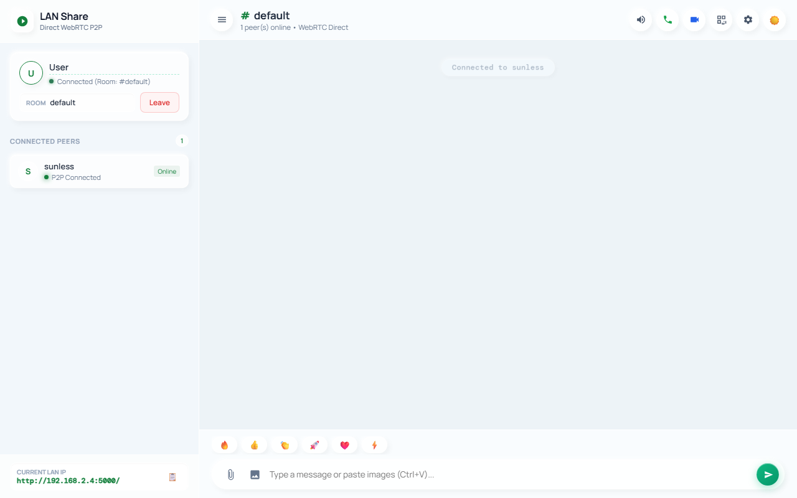
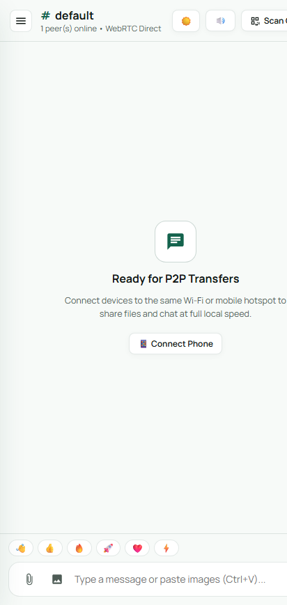
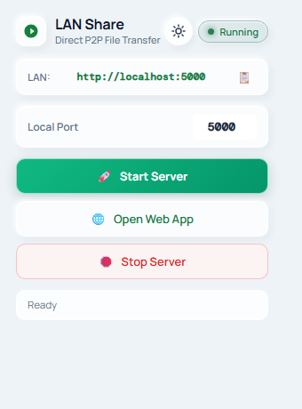

# LAN Share (WebRTC Direct P2P + Extension Launcher)

A fast, high-speed, local peer-to-peer file sharing and chat application designed to work **100% offline** over local Wi-Fi networks or mobile hotspots.

Built with direct **WebRTC DataChannels** (simple-peer), a **Python Flask + Socket.IO** signaling server, and a sleek **Chrome / Edge Extension Launcher** with Native Messaging.

---

## Key Highlights

- **100% Offline Capable**: Zero internet required. All client libraries (`socket.io.min.js`, `simplepeer.min.js`) are bundled locally within `/static/`. Transfers work at full Wi-Fi / Hotspot hardware speeds.
- **Solid Dark Green Theme (`#071f19`)**: Clean, distraction-free modern UI inspired by Telegram and WhatsApp Web. Pure solid colors with no blurry gradients or visual haze.
- **Chunked File Streaming with Flow Control**: Transfers files of any size with chunk-level backpressure management (`bufferedAmount` throttling) and real-time progress bars.
- **Queued Outbox**: Messages or files sent before a peer enters the room are held in a local outbox and automatically transmitted as soon as a peer connects.
- **Dynamic IP & Instant QR Codes**: Automatically detects network interface changes (e.g. connecting to a phone's mobile hotspot) and generates fresh QR codes on the fly via `/api/info` and `/qr.png`.
- **Clipboard & Media Sharing**: Paste screenshots directly from the clipboard (<kbd>Ctrl+V</kbd>), drag & drop files into the window, inspect photos in a full lightbox, and toggle audio chimes.
- **Multi-Tier Reliable Server Stop**: Stop button utilizes in-process HTTP signals (`/api/stop`), Win32 process termination, and PowerShell sweeps to guarantee instantaneous server shutdown.

---

## Screenshots

<div align="center">
  <h3>🖥️ Desktop Web Client</h3>
  
</div>

<br>

<div align="center">
  <table>
    <thead>
      <tr>
        <th align="center">📱 Mobile Web Interface</th>
        <th align="center">🧩 Extension Popup Launcher</th>
      </tr>
    </thead>
    <tbody>
      <tr>
        <td align="center" valign="top">
          
        </td>
        <td align="center" valign="top">
          
        </td>
      </tr>
    </tbody>
  </table>
</div>

---

## Project Structure

```
lan-share/
├── server.py                        # Flask + Socket.IO signaling relay & dynamic QR server
├── requirements.txt                 # Python dependencies
├── static/
│   ├── client.html                  # Full P2P messaging & file transfer web client
│   ├── socket.io.min.js             # Localized Socket.IO client (offline)
│   └── simplepeer.min.js            # Localized SimplePeer WebRTC client (offline)
├── extension/                       # Chrome & Edge Extension
│   ├── manifest.json                # Extension manifest v3
│   ├── popup.html                   # Extension popup UI (Solid Dark Green theme)
│   ├── popup.js                     # Server launcher & monitor
│   └── background.js                # Minimal service worker
├── native-host/                     # Native Messaging Host
│   ├── lan_share_host.py            # Python native host (start/stop server, PID tracker)
│   ├── lan_share_host_windows.json  # Chrome native host manifest
│   ├── start_server.bat             # Windows launcher wrapper
│   ├── register_native_host_windows.reg # Registry entry for Google Chrome
│   └── register_native_host_edge.reg    # Registry entry for Microsoft Edge
└── Photo/                           # Visual assets & screenshots
```

---

## Quick Start (Direct Server)

### 1. Prerequisites
Ensure Python 3.10+ is installed:
```bash
python --version
```

Install the required packages:
```bash
pip install -r requirements.txt
```

### 2. Run the Signaling Server
```bash
python server.py
```
By default, the server will bind to `0.0.0.0:5000` and display your local network IP:
```
📱 QR code saved as lan_share_qr.png (points to http://192.168.x.x:5000/)
🔗 Open on other devices: http://192.168.x.x:5000/
```

### 3. Open on Devices
- **Desktop**: Visit `http://localhost:5000/` in your browser.
- **Phone / Other PCs**: Connect to the same Wi-Fi or mobile hotspot and open `http://<your-lan-ip>:5000/` or scan the QR code.
- Ensure both devices join the same room name (default is `default`).

---

## Browser Extension Setup (Chrome, Edge & Brave)

The included browser extension allows you to start, monitor, and stop the LAN Share server directly from your browser toolbar.

### 1. Register the Native Messaging Host
Open the `native-host/` folder:
- **Automatic (Recommended)**: Double-click `install_native_host.cmd`. It automatically detects your project path and registers the native host for **Google Chrome**, **Microsoft Edge**, **Brave Browser**, and **Chromium**.
- **Manual**: Double-click `register_native_host_windows.reg`, `register_native_host_edge.reg`, or `register_native_host_brave.reg` and click **Yes**.

### 2. Load the Extension
1. Open your browser and navigate to `chrome://extensions`, `edge://extensions`, or `brave://extensions`.
2. Enable **Developer mode** (toggle in the top-right or sidebar).
3. Click **Load unpacked** and select the `extension/` directory.
4. Copy the newly generated **Extension ID** (e.g. `bolgcfjflofmejbacpjeolmgcicpblac`).
5. Ensure your extension ID is listed in `native-host/lan_share_host_windows.json` under `"allowed_origins"`.

### 3. Use the Extension
- Click the **LAN Share** icon in your extensions toolbar.
- Click **Start Server** to launch the server and open the web app.
- Click **Stop Server** to terminate the server.

---

## Mobile Hotspot Usage (Zero Internet)

1. Turn on your smartphone's **Portable Hotspot** (Mobile Data can be turned **OFF**).
2. Connect your laptop to the smartphone's Wi-Fi hotspot.
3. Start the LAN Share server on your laptop.
4. In the web app, click **Scan QR** or look at the detected IP in the bottom-left sidebar.
5. On your phone, open your mobile browser and navigate to the address shown.
6. Share files, images, and messages at full Wi-Fi speed without using any mobile data.

---

## Troubleshooting

- **Windows Firewall blocking mobile connections**:
  Windows often classifies mobile hotspots as "Public Networks". If other devices cannot reach port `5000`, run this command in PowerShell (Run as Administrator):
  ```powershell
  New-NetFirewallRule -DisplayName "LAN Share (Port 5000)" -Direction Inbound -LocalPort 5000 -Protocol TCP -Action Allow -Profile Any
  ```
- **Stopping server reports port busy**:
  The server supports a direct HTTP stop endpoint (`/api/stop`) as well as native host taskkill. If a port is held by an old session, restart the server via the extension or run:
  ```powershell
  Get-NetTCPConnection -LocalPort 5000 -ErrorAction SilentlyContinue | ForEach-Object { Stop-Process -Id $_.OwningProcess -Force }
  ```
- **Clipboard copying on mobile**:
  HTTP endpoints restrict the modern asynchronous Clipboard API on mobile. LAN Share includes an automatic `document.execCommand` fallback so the 📋 button works seamlessly everywhere.

---

## License

MIT License © 2025-2026 [Beebek Sharma](https://github.com/Beebek-Sharma)
